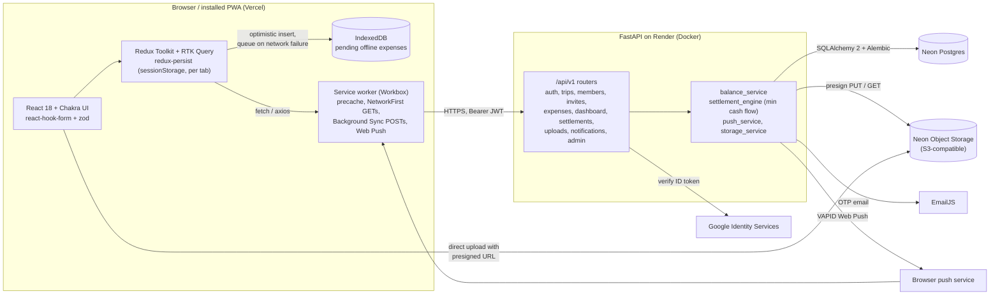

# Expense Tracker: case study (draft)

> Draft for the portfolio. Numbers below were measured on 2026-10-31 and are labelled with how they were measured. Anything marked TODO needs a real value before publishing.

## One-line pitch

A trip expense splitter, built as an installable PWA, that works on a patchy mountain-road connection and turns a week of shared spending into the fewest possible payments.

## The problem

Group trips produce dozens of small, uneven expenses: one person books the cab, another pays for dinner but two people skipped dessert, someone covers fuel for half the group. Splitting this in a chat thread or a spreadsheet breaks down fast:

- Splits are rarely equal, so people need exact amounts, percentages, or shares.
- Expenses happen where connectivity is worst (highways, hill stations, flights), so a web app that needs the network to save an expense gets abandoned.
- Settling up naively ("everyone pays everyone back") means many more transfers than necessary.

## Who it is for

Friends travelling together who want one shared ledger per trip, without everyone installing a native app. A trip admin creates the trip and shares an invite link; members add expenses from their phones, offline if needed, and see who owes whom at the end.

## What it does

- Trips with members, invite links, and per-trip admin roles
- Expenses with four split modes: equal, exact, percentage, shares
- Receipt photos uploaded directly to object storage
- Dashboard with member balances and spend by category, by member, and over time
- Suggested settlements that minimise the number of transfers, and recorded settlements
- Email OTP and Google sign-in
- Push notifications when someone adds an expense, settles up, or joins
- Offline reads, and offline expense creation that syncs on reconnect
- A separate platform-admin analytics view

## Architecture

**Frontend.** React 18 and TypeScript on Vite 5, Chakra UI, Redux Toolkit with RTK Query for every API call, react-hook-form with zod for forms, recharts for the dashboard. Every route is lazy-loaded. Hosted on Vercel with an SPA rewrite.

**Backend.** FastAPI with Pydantic v2 and sync SQLAlchemy 2 on psycopg2. 40 operations across 31 paths under `/api/v1` (counted from the running app's OpenAPI schema). Every response uses one envelope (`success`, `data`, `error`, `meta`), and custom exception handlers keep errors in that shape. A fixed-window rate limiter (120 requests per minute per IP) runs in process. Deployed as a Docker web service on Render's free tier.

**Data.** Postgres on Neon. Money is stored as `NUMERIC(12,2)`. Each expense stores its resolved per-member split amounts whatever the split mode, so balances never re-derive percentages or shares. Schema changes go through Alembic (two migrations so far).

**Auth.** Fully backend-owned (the project started on Firebase and moved off it). Email OTP codes are hashed with SHA-256 and compared in constant time. Google sign-in verifies the ID token server-side. The backend issues a short-lived JWT access token (60 minutes) and an opaque refresh token (30 days) that is stored only as a hash and rotated on use. On the client, concurrent 401s share a single in-flight refresh before retrying.

**Push.** One service worker handles caching and push. When an expense is added, a settlement is recorded, or a member joins, the backend writes a `notifications` row and best-effort pushes to every stored subscription via `pywebpush`. Expired subscriptions are pruned, and a push failure never fails the request that caused it.

**Offline.** The app shell is precached. API GETs are NetworkFirst with an 8 second timeout and a 24 hour cache. When creating an expense hits a network failure, the optimistic row stays in the list with a "will sync" badge and the request is queued: the service worker uses Background Sync where the browser supports it, and an IndexedDB queue replays on the `online` event everywhere else.

## Hard technical decisions

### 1. Owning auth instead of using a hosted provider

The first version used Firebase Auth and Firestore. It was replaced with backend-issued JWTs, email OTP, and Google ID-token verification, so all data and identity live in one Postgres database the backend controls.

*Trade-off:* the backend now owns hashing OTPs, refresh-token rotation, revocation on logout, and rate limiting, which a provider would have done for free. Email delivery goes through EmailJS on a connected Gmail account, which needs no domain verification but has low send limits and weaker deliverability than a transactional email service.

### 2. Two offline sync paths for adding expenses

Background Sync is only available in Chromium browsers, and iOS Safari, where many trip members will be, does not have it. So there are two paths: the service worker's Workbox Background Sync queue, and an IndexedDB queue that the page replays when it comes back online.

*Trade-off:* coverage on every browser, at the cost of two mechanisms that can both hold the same request. The backend does not yet accept an idempotency key, so on a browser with Background Sync a failed POST can be stored by both paths and replayed twice (see "What's next").

### 3. Greedy minimum-cash-flow settlements

Suggested settlements repeatedly match the largest creditor with the largest debtor until every balance is within one cent of zero. It is a pure function with no database or framework imports, so it can be unit tested in isolation.

*Trade-off:* finding the true minimum number of transfers is NP-hard in general, and greedy matching does not always reach it. In exchange it is simple, deterministic, fast for trip-sized groups, and never needs more than n - 1 transfers for n people with non-zero balances.

### 4. Presigned uploads straight to object storage

Receipts never pass through the API. The client asks for a presigned PUT URL, uploads directly to Neon's S3-compatible storage, and stores only the object key. Viewing goes through a short-lived presigned GET.

*Trade-off:* the free-tier API stays free of large request bodies and bandwidth, but there is more to configure (bucket, CORS), and a client that uploads and then abandons the form leaves an orphaned object.

### 5. Migrations on boot on a free host

Render's free tier has no pre-deploy hook, so the container's start command runs `alembic upgrade head` before starting uvicorn.

*Trade-off:* deploys need no manual step and an already-migrated database is a no-op, but every cold start pays the migration check. Running more than one instance would also mean concurrent migrations, which would need a lock or a separate release step.

### 6. Session state scoped to each browser tab

Redux state, including tokens, is persisted to `sessionStorage` under a per-tab key, so two tabs can be signed in as two different users. That makes testing a two-person split by hand easy, and tokens never sit in `localStorage`.

*Trade-off:* closing the tab or the installed PWA window signs you out, which is friction for a PWA people expect to reopen and find still signed in.

## Results

Measured locally on 2026-10-31 from the `revive` branch unless noted.

| What | Value | How |
| --- | --- | --- |
| Initial JS (entry + vendor chunks) | 157.3 kB + 71.9 kB gzip | `npm run build`, gzip -9 of the two scripts in `index.html` |
| Charts chunk (lazy) | 107.5 kB gzip | Vite build output |
| All JS | 448 kB gzip, 1,376 kB raw | Sum of `build/assets/*.js` |
| Service worker precache | 60 entries, 1,368.54 KiB | `vite-plugin-pwa` build output |
| Lighthouse, live `/login` (mobile) | Performance 80, Accessibility 95, Best Practices 100, SEO 91 | Lighthouse 12.2.1, headless Chrome, default mobile throttling |
| Lighthouse, live `/login` timings | FCP 3.7 s, LCP 3.9 s, TBT 30 ms, CLS 0.01 | Same run |
| Backend tests | 4 end-to-end pytest tests, all passing (2.8 s against local Postgres 14) | `pytest test_e2e.py` |
| Frontend tests | None yet | |
| Code size | about 6,700 lines of TS/TSX, about 3,800 lines of Python | `wc -l` |

Lighthouse only covered the login page, because every other route needs a signed-in user. The end-to-end tests cover OTP login, trip creation, adding a member, a two-member split expense, dashboard balances, suggested settlements, recording a settlement until balances reach zero, invites, and auth error cases.

TODO: real usage numbers (trips created, expenses logged, users) if any exist. Do not publish estimates.

## Screenshots to capture

Use a seeded trip with 4 members, around 15 expenses across categories, and mixed split types. Capture at 390x844 (phone), plus a desktop width for the dashboard.

1. `/login`: the desktop split layout with the pitch panel
2. `/`: trips list (Home)
3. `/trips/:tripId/expenses`: expense list with category icons, including one row with the offline "will sync" badge (DevTools > Network > Offline, then add an expense)
4. `/trips/:tripId/expenses/new`: add expense with the split selector set to percentage or shares
5. `/trips/:tripId/expenses/:expenseId`: expense detail showing each member's share
6. `/trips/:tripId/dashboard`: balances plus category pie, by-member bar, and timeline line charts (phone and desktop)
7. `/trips/:tripId/settlements`: suggested settlements next to recorded ones
8. `/trips/:tripId/members`: invite link and member roles
9. `/invite/:code`: invite landing as a signed-out visitor
10. A push notification on a phone after another member adds an expense
11. The browser's "Install app" option, the home-screen icon, and the app opened standalone
12. `/admin`: platform analytics (blur any real emails)

## What's next

- **Idempotent expense creation.** Accept a client-generated id (the existing `X-Offline-Local-Id`) with a unique constraint, so a replayed offline request can never create a duplicate. Then the two sync paths can safely overlap.
- **Demo mode.** A "Try the demo" button that signs a visitor into a private, pre-seeded sandbox trip that expires after 24 hours, so reviewers do not need OTP or Google.
- **Frontend tests.** Unit tests for split maths and the zod schemas, and a Playwright run of the add-expense, offline, and settle-up flows.
- **Money as decimals end to end.** Balances are computed in floats with cent rounding. Switching `balance_service` to `Decimal` removes a class of rounding edge cases.
- **Bundle size.** The entry chunk is 157 kB gzip, mostly UI library code. Splitting the auth screens from the app shell, or moving off Chakra 2, would bring first load down.
- **Remember me for the PWA.** An opt-in persistent refresh token for installed-app users.
- **Shared rate limiting.** Move the in-memory limiter to Redis before running more than one instance.
